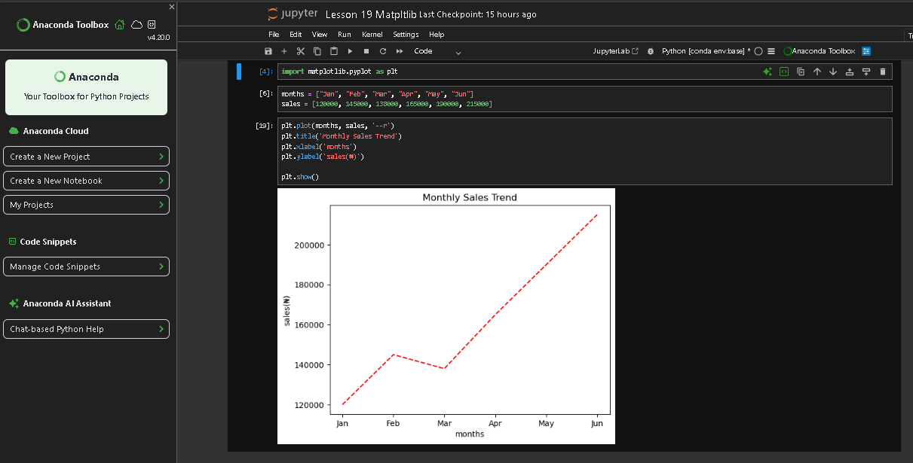
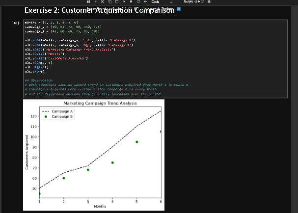
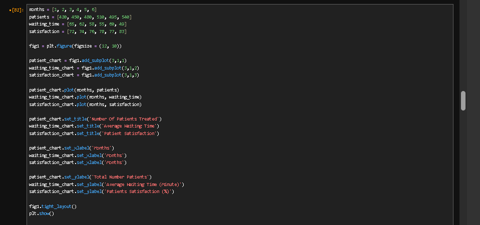
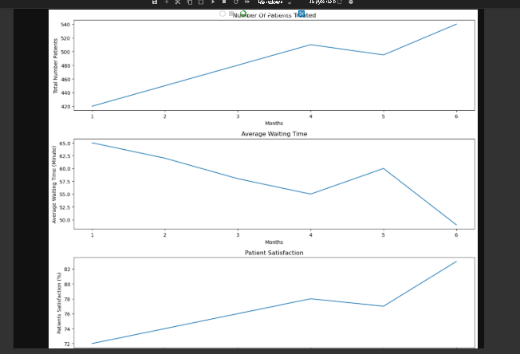
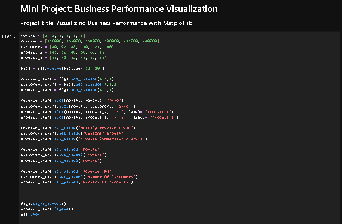
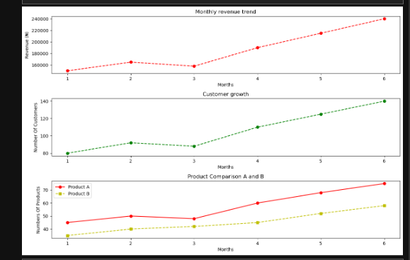

# Business Performance Visualization with Matplotlib

## Project Overview

This project explores how Python and Matplotlib can be used to visualize business performance and communicate useful insights from data.

The project uses six months of sample business data to examine revenue trends, customer growth, and product sales. The aim is to turn raw numbers into visualizations that are easier to understand and use when asking business questions.

This project was completed as part of my Python learning journey in the **Python Study Group (PSG), under Coach Timothy Amaefule at SmartBizCrux Technologies**.

## Business Problem

A business owner wants to understand how the business has performed over six months.

The key questions are:

- How has monthly revenue changed?
- How has the customer base grown?
- Which product recorded higher sales?
- What additional information is needed to make better business decisions?

## Project Objectives

- Create line charts using Matplotlib.
- Visualize monthly revenue and customer trends.
- Compare the sales performance of two products.
- Customize charts with titles, axis labels, colours, markers, and legends.
- Arrange multiple charts in one figure using subplots.
- Interpret trends and communicate findings without making unsupported assumptions.

## Tools and Technologies

- Python
- Jupyter Notebook
- Matplotlib
- GitHub

## Dataset

The dataset contains six months of sample business data.

| Variable | Description |
|---|---|
| `months` | Reporting months 1–6 |
| `revenue` | Monthly revenue in Nigerian naira |
| `customers` | Number of customers recorded each month |
| `product_a` | Monthly units sold for Product A |
| `product_b` | Monthly units sold for Product B |

The data was supplied for a learning exercise and is not presented as actual company performance.

## Visualizations

### 1. Monthly Revenue Trend

A line chart showing revenue over six months, with styling and markers to make changes easier to identify.

### 2. Customer Growth

A line chart tracking the number of customers recorded each month.

### 3. Product Performance Comparison

A comparative line chart showing monthly sales for Product A and Product B, using different styles and a legend to distinguish the products.

## Key Findings

### Revenue

Revenue increased from ₦150,000 in Month 1 to ₦240,000 in Month 6. There was a decline in Month 3, from ₦165,000 to ₦158,000, followed by growth in the remaining months.

### Customer Growth

Customer numbers increased from 80 in Month 1 to 140 in Month 6. The only decline occurred in Month 3, when the number fell from 92 to 88.

### Product Performance

Product A recorded 75 units sold in Month 6, compared with 58 units for Product B. Product A also recorded higher sales in every month of the dataset.

### Business Interpretation

Revenue and customer numbers followed similar patterns throughout the period. Both declined in Month 3 and increased in the other month-to-month comparisons.

These patterns are useful observations, but the charts alone do not explain why the changes occurred.

Before recommending business actions, further information about product prices, operating costs, profit margins, marketing activities, and customer purchasing behaviour would be useful.

## Skills Demonstrated

- Data visualization with Matplotlib
- Line charts and subplot layouts
- Chart styling and customization
- Titles, axis labels, and legends
- Trend identification and comparison
- Business-focused data interpretation
- Communicating findings and analytical limitations

## Project Structure

```text
matplotlib-business-performance-visualization/
├── Lesson 19 Matpltlib.ipynb
├── README.md
└── images/
    └── business-performance-charts.png
```

## Project Screenshots

### Retail Sales Trend Analysis











## Learning Reflection

This project helped me practise using Matplotlib to create and customize charts, arrange subplots, compare data series, and interpret business trends.

It also reinforced an important lesson: a chart can reveal patterns in data, but additional evidence is needed to explain the causes of those patterns and support business recommendations.

## Acknowledgement

This project forms part of my ongoing Python learning journey in the Python Study Group under Coach Timothy Amaefule at SmartBizCrux Technologies.

## Author
Ismaila Aminu Ainoko

I am continuing to build my skills through practical exercises, portfolio projects, and consistent learning.
